# Voos para países anglófonos × intenção de estudar inglês

Análise final de dados do Projeto Integrador, grupo 4, para o beneficiário Boost Your English. Versão de novembro de 2026.

## 1. Pergunta

A demanda por aulas de inglês acompanha as viagens de brasileiros para países de língua inglesa? Se acompanha, em que momento do ano, com quanto de atraso e em quais regiões?

Como o cliente não tem histórico de matrículas, a demanda é medida pelo **interesse de busca no Google Trends** (proxy de intenção), e as viagens pelos **voos comerciais da ANAC** do Brasil para Estados Unidos, Canadá e Reino Unido.

## 2. O que foi cruzado

| | Voos (ANAC) | Intenção (Google Trends) |
|---|---|---|
| Período | 29/12/2024 a 01/08/2026 | o mesmo |
| Granularidade | semana (domingo a sábado) | semana (domingo a sábado) |
| Medidas | voos, passageiros, passageiros por voo, por país de destino | 5 termos de intenção, índice composto, 4 termos de contexto e controle |
| Regional | UF e município do aeroporto de embarque | UF |
| Tamanho | 18.327 voos, 4.568.452 passageiros | 9 termos nacionais, 5 UFs, mapa das 27 UFs |

Chave do cruzamento: a semana (`semana_inicio`). São 83 semanas, 81 completas; só as completas entram nos testes. No recorte regional, a chave é semana + UF, e o cruzamento com os dois lados completos só é possível em **SP, RJ e MG** (detalhes na `METODOLOGIA.md`, seção 11).

Um cuidado que vale para tudo o que segue: semanas vizinhas são muito parecidas entre si, então 81 semanas equivalem a algo entre 15 e 40 observações independentes. Todos os p-valores abaixo já descontam isso (seção 12 da metodologia). Com 19 meses de dados há só um ano e meio de sazonalidade observada.

## 3. Achados

### 3.1 As duas séries sobem juntas, mas a busca vem depois

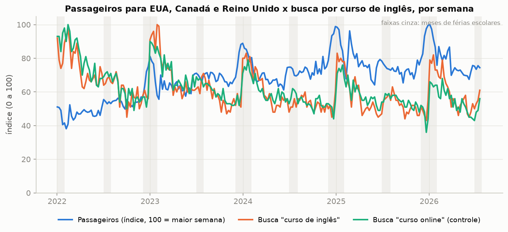

Os embarques têm dois picos por ano, nas férias de dezembro e janeiro e, menor, em julho. A semana de maior movimento foi a de 4 de janeiro de 2026 (71.116 passageiros) e a menor, a de 1º de junho de 2025 (45.634). Nas semanas de férias escolares embarcam em média 60.505 passageiros por semana, contra 52.899 no período letivo.

A busca por "curso de inglês" também tem o pico em janeiro, mas ele chega depois: em 2026 os embarques chegaram ao máximo na semana de 4 de janeiro e a busca, na de 18 de janeiro.

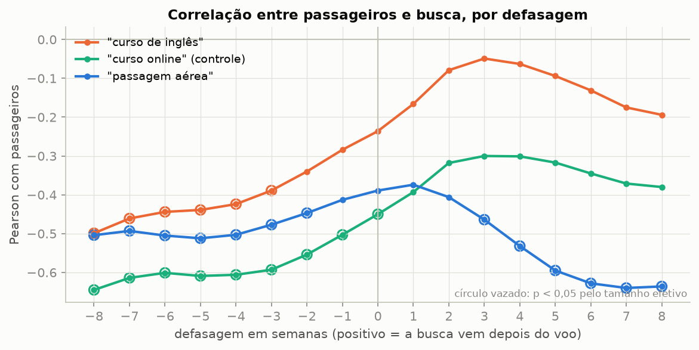

Na mesma semana a correlação entre passageiros e busca por curso de inglês é moderada e não significativa (r = 0,49; p = 0,07). Ela cresce quando a busca é deslocada para depois do voo e chega ao máximo com **3 semanas de atraso (r = 0,81; p < 0,001)**. O índice composto dos cinco termos de intenção tem o mesmo desenho, mais fraco (r = 0,65 com 4 semanas; p = 0,003).

Como verificação do método, a busca por "passagem aérea" tem o pico de correlação na semana do próprio voo (r = 0,48), como se espera de quem está comprando a viagem.

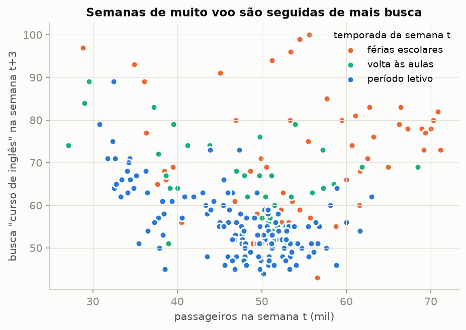

A relação não depende de poucos pontos extremos: as semanas de período letivo formam a nuvem de baixo à esquerda e as de férias, a de cima à direita, com uma transição contínua entre elas.

### 3.2 Termos diferentes, públicos diferentes

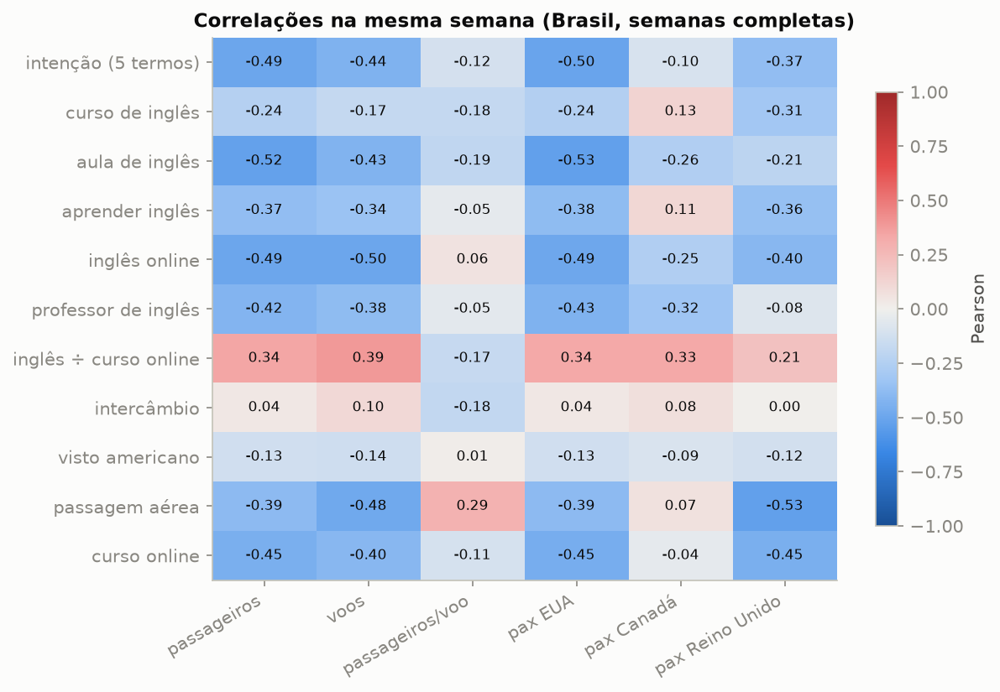

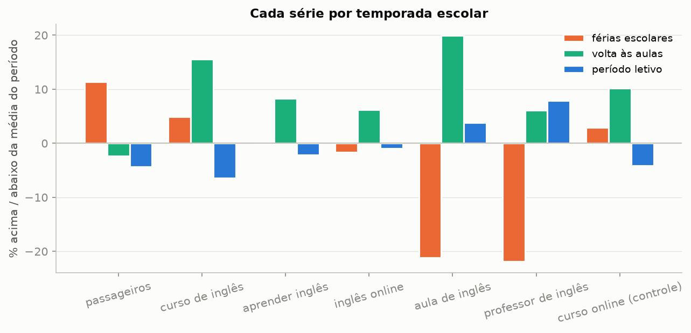

Os termos de intenção não se comportam como um bloco:

| Termo | Férias escolares | Volta às aulas | Período letivo | Correlação com passageiros, mesma semana |
|---|---|---|---|---|
| curso de inglês | +8,5% | +16,4% | -8,2% | 0,49 |
| aprender inglês | +2,3% | +11,2% | -3,9% | 0,19 |
| inglês online | -0,8% | +6,6% | -1,3% | 0,17 |
| aula de inglês | -19,7% | +21,4% | +3,8% | -0,27 |
| professor de inglês | -18,6% | +6,0% | +7,2% | -0,27 |
| curso online (controle) | +2,1% | +10,8% | -3,7% | 0,29 |

(percentuais: média da temporada contra a média do período)

"Curso de inglês" sobe nas férias e na volta às aulas, junto com as viagens. "Aula de inglês" e "professor de inglês" caem cerca de 20% nas férias e sobem no ano letivo: seguem o calendário escolar, o perfil de reforço e aula particular. A correlação de "aula de inglês" com os voos só fica positiva com 5 a 8 semanas de atraso (até r = 0,57), ou seja, quando o período letivo volta.

### 3.3 Destinos

Os Estados Unidos concentram 83% dos passageiros e reproduzem o resultado geral (r = 0,80 com 3 semanas). Canadá vem atrás (r = 0,53 com 3 semanas). A série semanal do Reino Unido é irregular (autocorrelação de 0,12 contra 0,8 das demais) e não tem um pico de correlação claro.

A busca por "visto americano" não acompanha o fluxo de passageiros (r = 0,09 na mesma semana). Ela tem picos isolados nas semanas de 13 de julho de 2025 e 11 de janeiro de 2026, sem contrapartida nos embarques, o padrão típico de busca movida por notícia.

A Copa do Mundo de 2026, nos EUA, Canadá e México, não aparece nos embarques: nas semanas 24 a 29 de 2026 embarcaram 3,3% menos passageiros que nas mesmas semanas de 2025 (4,1% menos para os EUA). A ocupação dos voos varia pouco (média de 250 passageiros por voo); os picos vêm de mais voos, não de voos mais cheios.

### 3.4 Regional

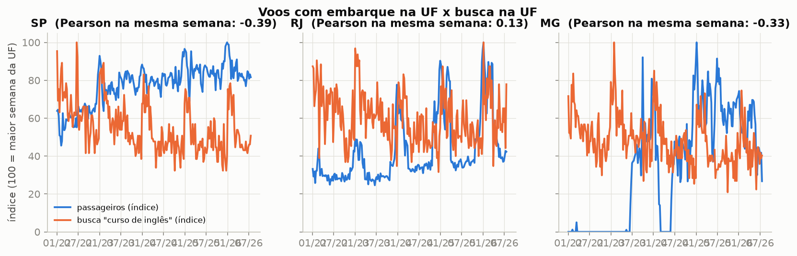

| UF | Mesma semana | 3 semanas depois | Sem dezembro e janeiro, mesma semana |
|---|---|---|---|
| RJ | **0,46 (p = 0,009)** | 0,48 (p = 0,006) | **0,47 (p = 0,009)** |
| SP | 0,09 (p = 0,64) | **0,58 (p = 0,001)** | -0,24 (p = 0,11) |
| MG | -0,10 (p = 0,51) | 0,18 (p = 0,25) | -0,18 (p = 0,25) |

O Rio de Janeiro tem o sinal regional mais limpo: os embarques no Galeão e a busca no estado sobem juntos na mesma semana, inclusive fora do verão. Em São Paulo a relação só aparece com atraso, e some sem dezembro e janeiro: Guarulhos é hub nacional, então seus embarques medem viajantes do país inteiro, não de São Paulo. Em Minas não há relação.

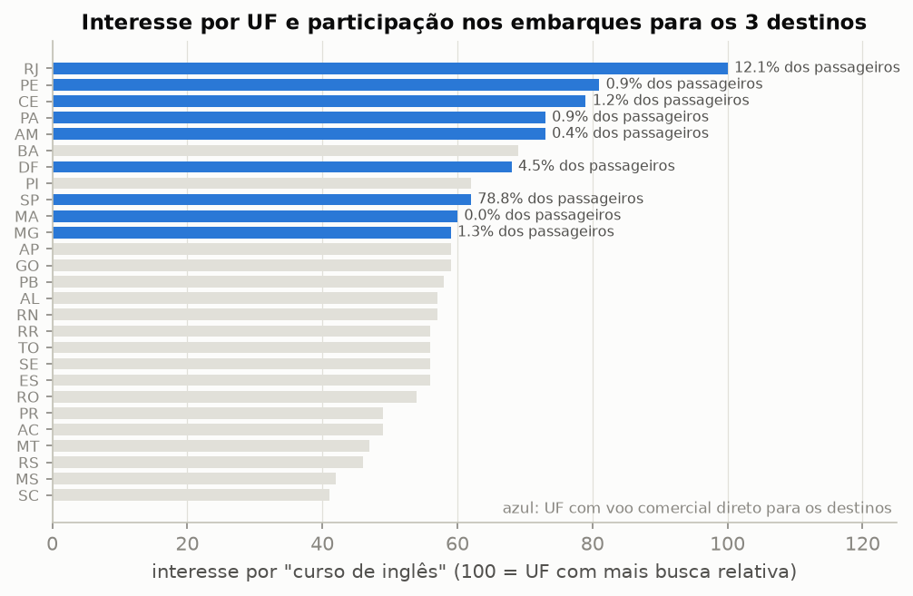

O Rio de Janeiro é também a UF com maior interesse relativo por curso de inglês do país. Entre as UFs, porém, não há relação entre o interesse e o volume de embarque (Spearman = -0,07 nas 8 UFs com voo; p = 0,87): o interesse relativo alto no Norte e no Nordeste (Pará, Amazonas, Pernambuco, Ceará) não vem acompanhado de muitos embarques para esses destinos.

## 4. Férias ou destino?

A pergunta que ficou dos achados acima: a busca por inglês reage à viagem para um país de língua inglesa ou às férias, que levam gente para qualquer lugar? Os voos para os outros destinos internacionais (Argentina, Chile, Portugal, Panamá...) entram como grupo de comparação, em tabelas separadas do recorte (`METODOLOGIA.md`, seção 15). Eles são quatro vezes maiores que o recorte: 18,8 milhões de passageiros contra 4,6 milhões.

### 4.1 Viagem de férias para qualquer destino vem antes da busca

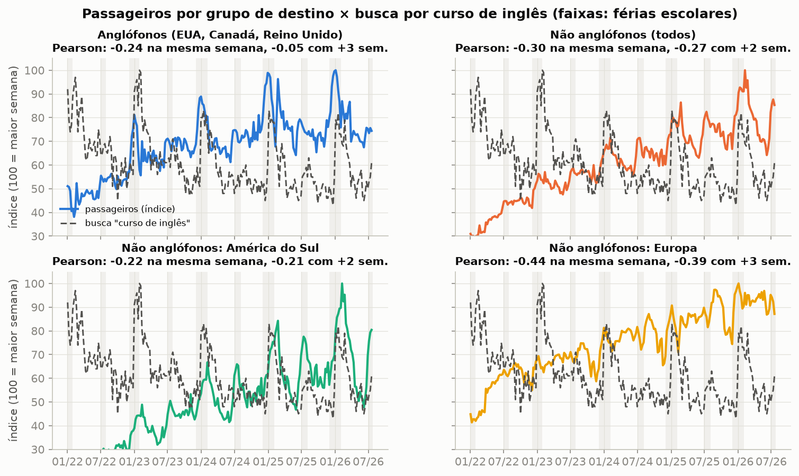

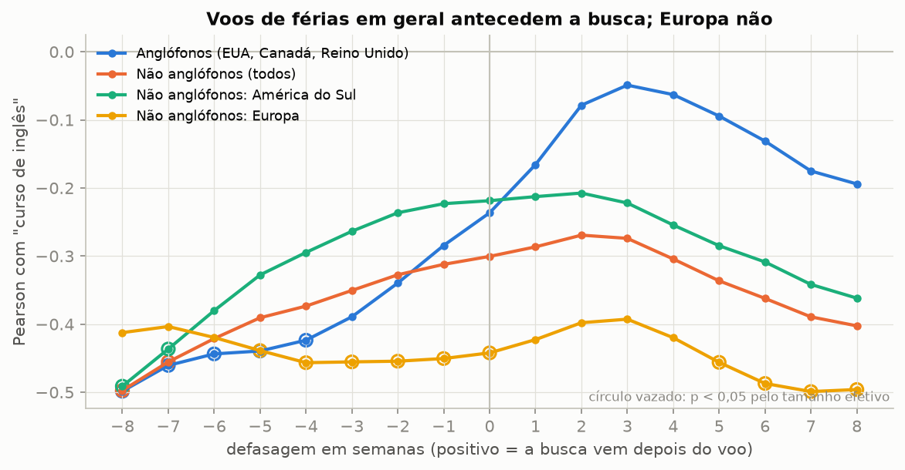

| Destino | Mesma semana | Pico | Perfil nas férias escolares |
|---|---|---|---|
| Anglófonos (EUA, Canadá, Reino Unido) | 0,49 | **0,81 com 3 semanas** (p < 0,001) | +9% |
| Não anglófonos, todos | 0,60 | **0,69 com 2 semanas** (p = 0,02) | +8% |
| América do Sul | **0,67** (p = 0,04) | 0,67 na mesma semana | +11% (e +20% na volta às aulas, fevereiro e agosto) |
| América Central e México | 0,15 | 0,51 com 3 semanas (p = 0,02) | +10% |
| Europa (não anglófona) | -0,01 | 0,25 com 3 semanas (p = 0,37) | +1% |
| Internacional, todos os destinos | 0,62 | 0,76 com 3 semanas (p = 0,004) | |

O padrão aparece em todos os destinos que lotam nas férias escolares brasileiras, falem inglês ou não. A Europa é o contraste que ajuda a ler o resto: é viagem longa e cara, como para os EUA, mas não segue as férias escolares (o movimento é quase o mesmo nas três temporadas) e não tem relação com a busca.

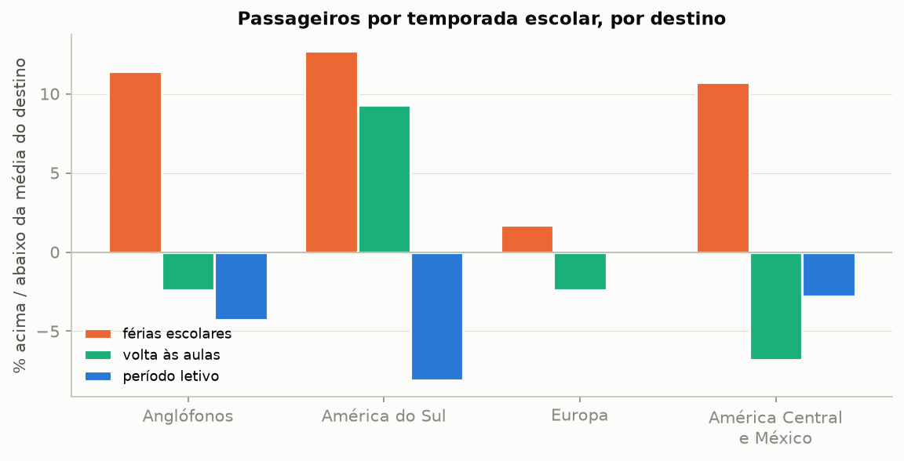

### 4.2 Para onde se viaja não muda a busca

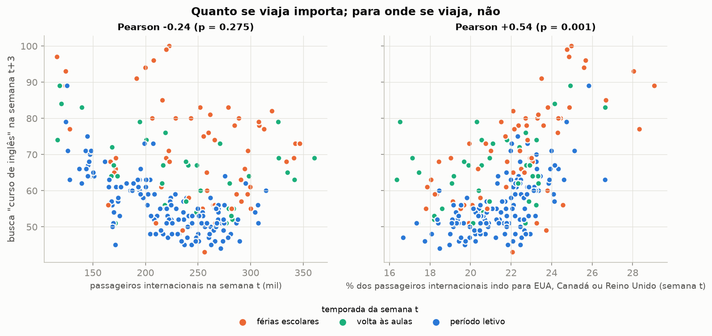

Se o destino importasse, as semanas em que uma fatia maior dos viajantes vai para EUA, Canadá ou Reino Unido seriam seguidas de mais busca por inglês. Essa fatia varia de 16% a 23% ao longo do período e **não tem relação com a busca** em nenhuma defasagem (r = 0,17 com 3 semanas; p = 0,48). O volume total de viagem internacional, sim (r = 0,76).

### 4.3 O que os voos anglófonos ainda acrescentam

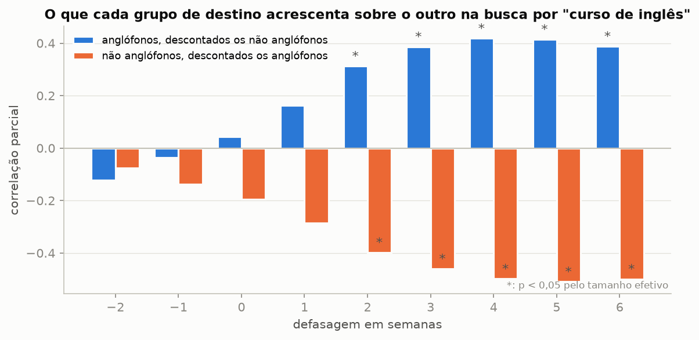

Os dois grupos andam juntos (correlação de 0,60 entre si), então vale perguntar o que cada um explica além do outro:

- Descontados os não anglófonos, os anglófonos ainda têm correlação parcial de **0,68** com a busca 3 semanas depois. Descontados os anglófonos, os não anglófonos ficam em **0,43**. Os dois são significativos.
- Sozinhos, os anglófonos explicam 65% da variação da busca 3 semanas depois; os não anglófonos, 47%; juntos, 71%.

Isso não quer dizer que o idioma do destino seja o motivo. Os voos anglófonos também explicam melhor a busca por **"curso online"**, o controle sem relação com inglês (parcial de 0,46), porque o pico deles cai exatamente na virada do ano, o mesmo momento em que todo o calendário educacional acelera. O componente específico do inglês (curso de inglês ÷ curso online) é o único lugar em que sobra um rastro do destino: parcial de 0,38 para os anglófonos e 0,13, não significativa, para os não anglófonos.

**Leitura:** a busca por inglês acompanha a temporada de férias, e os voos para países anglófonos são o termômetro mais preciso dessa temporada porque o pico deles coincide com a virada do ano. O destino de língua inglesa deixa um efeito próprio pequeno, perto do limite do que 19 meses de dados permitem medir. As férias pesam mais que o destino.

## 5. Hipóteses testadas

| | Hipótese | Teste | Resultado | Veredito |
|---|---|---|---|---|
| H1 | Os picos de viagem a países anglófonos coincidem com os picos de intenção de estudar inglês | correlação semanal com defasagem de -8 a +8 semanas | r = 0,49 na mesma semana (p = 0,07); **r = 0,81 três semanas depois (p < 0,001)** | **confirmada com atraso**: a busca sobe 2 a 4 semanas depois dos embarques |
| H2 | É só o calendário educacional genérico (início de ano e de semestre) | correlação parcial controlando por "curso online"; razão inglês ÷ curso online | "curso online" também correlaciona (r = 0,65 com 3 semanas), mas a parcial de curso de inglês continua em **0,62 (p < 0,001)** e a razão correlaciona 0,50 (p = 0,008) | **rejeitada em parte**: o calendário explica uma parte; sobra um componente específico do inglês |
| H3 | É só janeiro (resoluções de ano-novo) | correlação sem dezembro e janeiro; julho contra junho | sem dez/jan: **r = 0,55 com 2 semanas (p = 0,004)**. Em julho, curso de inglês sobe 13,6% (2025) e 14,1% (2026) sobre junho, contra 10,1% e 7,9% de curso online | **rejeitada**: o efeito aparece também nas férias de julho, onde não há ano-novo |
| H4 | Quem vai viajar procura curso antes (a busca antecede o voo) | correlações com defasagem negativa; precedência de Granger | nenhuma correlação significativa antes do voo (máximo 0,37 uma semana antes; p = 0,18); Granger busca → voos: p entre 0,33 e 0,88. Voos → busca: **p = 0,001 com 3 semanas** | **rejeitada no horizonte de 8 semanas**; a ordem observada é voo, depois busca |
| H5 | Anos com mais viagem têm mais busca | ano contra ano na mesma semana (semanas 2 a 29) | r = -0,31 (p = 0,14); passageiros -2,2% e busca +1,1% em média | **não sustentada**: a relação é sazonal, não de nível |
| H6 | Os termos de intenção representam o mesmo público | perfil por temporada e correlação por termo | curso: sobe nas férias; aula e professor: caem cerca de 20% nas férias e sobem no letivo | **rejeitada**: "curso" acompanha as viagens; "aula" e "professor", o calendário escolar |
| H7 | A relação se repete na UF de embarque | correlação semanal por UF | RJ: 0,46 na mesma semana, robusta sem verão; SP: só com atraso (hub); MG: nenhuma. Entre UFs: nenhuma | **confirmada no RJ**, inconclusiva em SP, rejeitada em MG |
| H8 | O efeito é do destino de língua inglesa, não das férias | voos para destinos não anglófonos como grupo de comparação; correlação parcial; participação anglófona | não anglófonos também antecedem a busca (r = 0,69); a Europa, que não segue as férias, não (0,25, n.s.); a fatia anglófona não explica a busca (0,17, n.s.); os anglófonos mantêm parcial de 0,68, mas boa parte é coincidência de calendário (também explicam "curso online") | **rejeitada na maior parte**: as férias pesam mais que o destino; sobra um efeito específico pequeno (parcial de 0,38 na razão inglês ÷ curso online) |

## 6. Conclusões

1. **Existe relação entre viagens para países anglófonos e intenção de estudar inglês, mas ela não é simultânea.** A busca por curso de inglês sobe de 2 a 4 semanas depois dos picos de embarque, nas férias de verão e também nas de julho.
2. **A relação não é só o calendário escolar.** Um termo de controle sem relação com inglês ("curso online") explica parte do movimento, mas o componente específico do inglês continua correlacionado com os voos depois do controle.
3. **A ordem é viagem, depois busca.** Nos dados semanais, os voos ajudam a prever a busca das semanas seguintes e a busca não ajuda a prever os voos. Isso é precedência, não prova de causa.
4. **Três mecanismos são compatíveis com esse resultado** e a base não permite separá-los: o contato com o idioma na viagem leva à decisão de estudar ao voltar; o fim das férias é o momento em que as pessoas planejam o semestre; viajantes e estudantes de inglês são o mesmo grupo de renda e reagem ao mesmo calendário. O resultado de julho e o controle por "curso online" pesam contra uma explicação puramente de calendário.
5. **"Curso" e "aula" são públicos diferentes.** O interesse por curso de inglês acompanha as viagens; o interesse por aula e professor de inglês segue o ano letivo e cai nas férias.
6. **Regionalmente, o Rio de Janeiro é o caso mais claro**: maior interesse relativo do país e relação semanal com os embarques, inclusive fora do verão. Em São Paulo o efeito hub de Guarulhos impede ler os embarques como demanda paulista.
7. **As férias pesam mais que o destino.** Voos de férias para destinos que não falam inglês (América do Sul, América Central) também vêm antes da busca; a viagem para a Europa, que não segue as férias escolares, não; e a fatia de viajantes indo para países de língua inglesa não muda a busca. Os voos para EUA, Canadá e Reino Unido são o melhor termômetro da temporada, mas o efeito próprio do destino é pequeno.

## 7. O que isso significa para a Boost Your English

1. **Calendário de captação.** As janelas de maior intenção vêm logo depois das férias: da segunda quinzena de janeiro a fevereiro, e do fim de julho a agosto. São os momentos para campanhas de matrícula e para abrir turmas em grupo, que dependem de juntar alunos numa janela curta. Como o que move a busca é a temporada de férias, e não o destino, a mensagem não precisa se limitar a quem viajou para fora: vale para qualquer público que volta das férias.
2. **Mensagem por público.** Nas janelas pós-férias, comunicação de curso (objetivo de viagem, carreira, fluência). Durante o período letivo (fevereiro a junho e agosto a novembro), oferta de aula individual e professor particular, que é quando "aula" e "professor" são mais buscados. Nas férias, a procura por aula avulsa cai cerca de 20%.
3. **Indicador para o painel do cliente.** O próprio Google Trends (semanal e quase em tempo real) é o sinal operacional. Os voos da ANAC servem para confirmar o calendário, mas são publicados com atraso e não substituem o Trends no dia a dia.
4. **Regional.** Se o cliente fizer mídia segmentada, o Rio de Janeiro reúne o maior interesse relativo e a relação mais estável com viagens.

## 8. Limitações

- **Período curto.** 19 meses, um ano e meio de sazonalidade, 15 a 40 observações efetivas. Os resultados são evidência moderada, não estimativas precisas de tamanho do efeito.
- **Proxy de demanda.** O Trends mede interesse de busca relativo, não matrícula nem volume. O índice é amostral; coletas diferentes variam um pouco.
- **Destino e calendário se confundem.** Os voos anglófonos têm o pico na virada do ano, junto com todo o calendário educacional; com um ano e meio de dados não dá para separar completamente o efeito do destino do efeito da data (seção 4.3).
- **Aeroporto não é residência.** A UF da ANAC é a do aeroporto de embarque; Guarulhos concentra conexões do país.
- **Cobertura regional do Trends.** Série semanal utilizável só em SP, RJ e MG; DF tem 17 de 83 semanas com dado; não existe série por cidade.
- **Endpoints não oficiais.** A coleta usa as mesmas chamadas da página do Trends; o Google pode mudá-las sem aviso.

## 9. Próximos passos

1. **Dados do próprio sistema.** Assim que o sistema de agendamento registrar início e fim de contratos, trocar o Trends pelas matrículas reais e reestimar a defasagem.
2. **Mais um ano de dados.** Com 2 anos completos é possível decompor a sazonalidade (STL) e testar se a defasagem de 3 semanas é estável.
3. **Volume absoluto.** Complementar com o Planejador de Palavras-chave do Google Ads, que dá a ordem de grandeza das buscas que o Trends só mostra como índice.

## Arquivos

| Arquivo | Conteúdo |
|---|---|
| `data/gold/` | as tabelas gold: quatro do recorte (seção 11 da metodologia) e três do grupo de comparação (seção 15) |
| `graficos/cruzamento/` | os gráficos deste documento e `resultados.json`, com todos os números dos testes |
| `graficos/comparacao_destinos/` | os gráficos da seção 4 (férias ou destino) e o `resultados.json` desses testes |
| `scripts/analise_hipoteses.py` | gera os testes e os gráficos a partir da gold |
| `scripts/analise_destinos.py` | testes e gráficos do grupo de comparação |
| `grafana/` | dashboard interativo com os mesmos cruzamentos e seletores de termo, série, defasagem e UF |
| `METODOLOGIA.md` | como cada tabela foi construída |
| `entrega_eda/EDA_Grupo4_Dicionario.xlsx` | dicionário de dados, com as abas novas Voos semanal, Google Trends, Gold e Comparação destinos |
